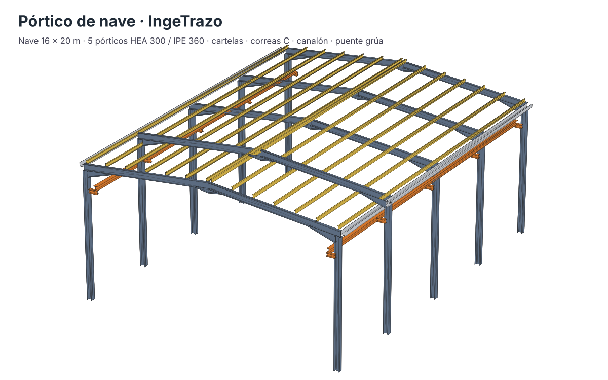

# Pórtico de nave — extensión para IngeTrazo

Genera en [IngeTrazo](https://ingetrazo.com) una nave industrial de pórticos
metálicos a dos aguas, paramétrica y editable.

## Contenido del modelo

- Pilares y dinteles con perfiles europeos IPE, HEA y HEB.
- Dintel opcionalmente distinto en los pórticos extremos (primero y último).
- Alturas de alero independientes en cada fachada: la pendiente es común y la
  cumbrera se desplaza hacia la fachada más alta.
- Cartelas de alero y de cumbrera (alma y ala inferior en chapa).
- Correas C o Z conformadas, o IPE, repartidas por faldón con una separación
  máxima.
- Canalón exterior en U.
- Puente grúa opcional: ménsulas en los pilares y viga carril, con aviso de
  interferencia con el dintel y la cartela.
- Cruces de San Andrés en redondo macizo, en cubierta y en fachadas
  laterales, en los vanos extremos o en todos.

Cada pórtico es un componente: los interiores comparten una definición y los
extremos otra (una sola si el dintel es el mismo). Dentro de ellos, pilares,
dinteles, cartelas y ménsulas son también componentes. Las piezas llevan
etiquetas (Estructura, Correas, Canalones, Puente grúa, Arriostramientos) y
clase BIM (IfcColumn, IfcBeam, IfcMember), de modo que la exportación IFC
sale clasificada.

Interfaz en español e inglés: el idioma se elige en el cuadro de parámetros y
se conserva para las sesiones siguientes.

Los parámetros se guardan en la nave, dentro del `.igz`: **Editar nave…** la
regenera en el mismo lugar aunque se haya movido o girado, en un solo paso de
deshacer. **Medición de acero…** da la tabla de pesos por elemento y la copia
al portapapeles para Excel.

## Instalación

1. En IngeTrazo: **Extensiones ▸ Abrir carpeta de complementos**
   (Windows: `%APPDATA%\ingetrazo\plugins\`; Linux:
   `~/.local/share/ingetrazo/plugins/`).
2. Copie `portico_nave.py` en esa carpeta y reinicie IngeTrazo.
3. Órdenes en **Extensiones ▸ Pórtico de nave** y en el menú contextual de una
   nave seleccionada.

También puede instalarse desde **Extensiones ▸ Gestionar extensiones…** una
vez publicada en el catálogo.

## Convenios

- Luz: distancia entre caras exteriores de pilares.
- Altura de alero: cota de la cara superior del dintel en la cara exterior del
  pilar, en cada fachada.
- Cruces de fachada en el plano del eje de pilares; cruces de cubierta en un
  plano paralelo al faldón, bajo la cara superior del dintel.
- Cota de ménsula: cara superior (apoyo de la viga carril). Vuelo: de la cara
  interior del pilar al eje de la viga carril.
- Pesos nominales de catálogo, sin uniones, placas ni rigidizadores.

El modelo es geométrico: no sustituye al cálculo estructural (CTE DB SE-A /
EN 1993-1-1).

Probada con IngeTrazo 0.6.2.1. La API de extensiones de IngeTrazo no es aún
estable (serie 0.x).

## Licencia

GPL-3.0-or-later. © 2026 José María Martín García-Donas (Donas Ingenieros).
